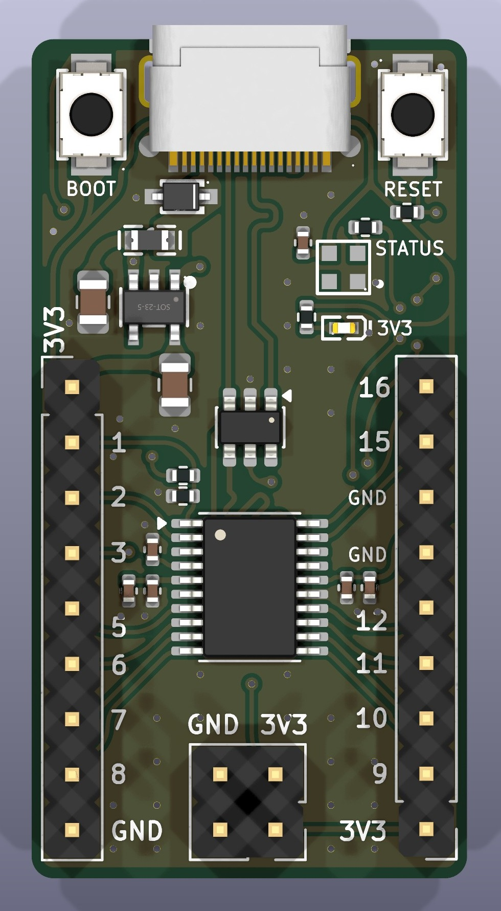
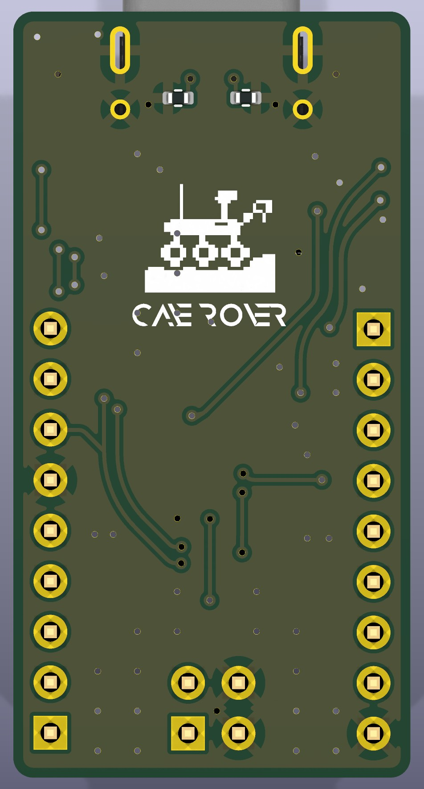
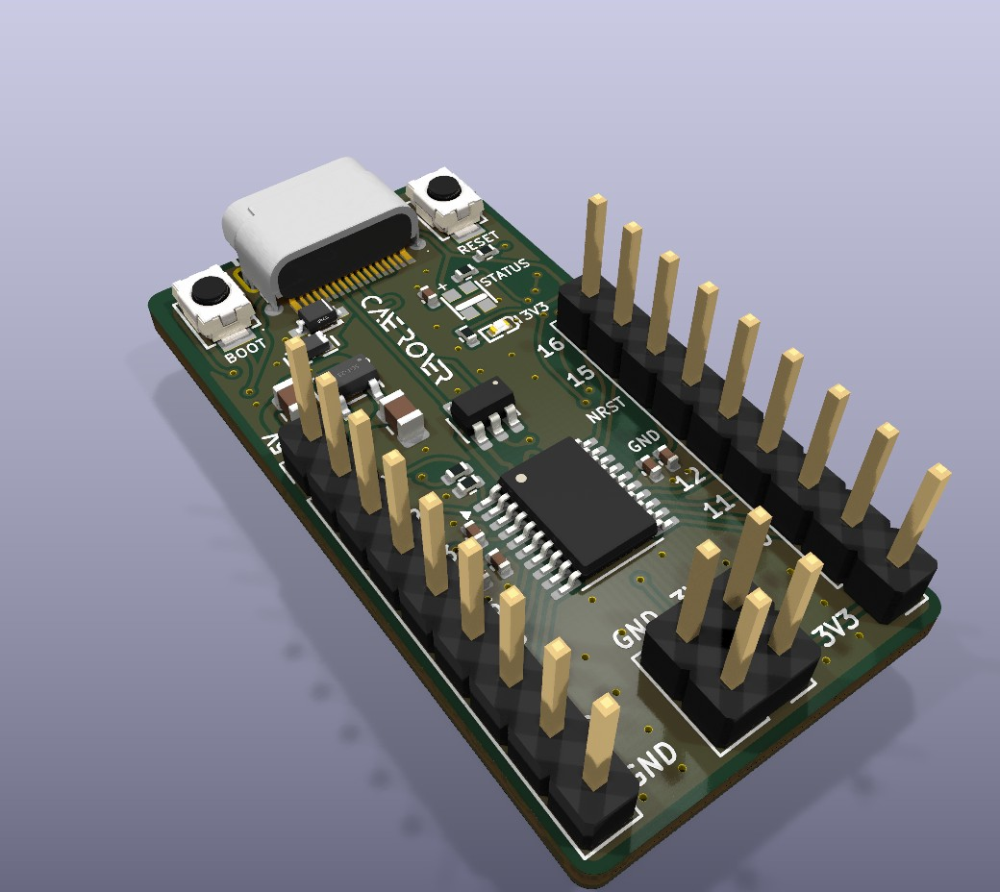
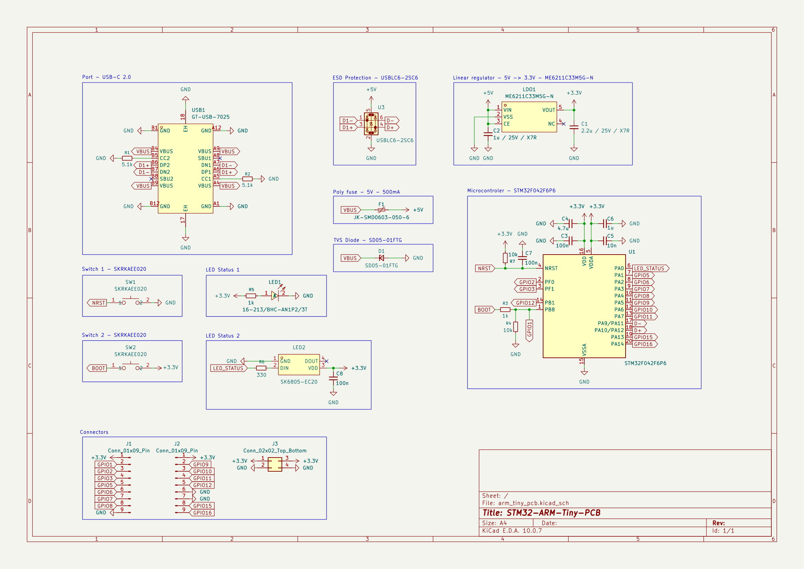

<div align="center">


# ⚡ NanoCortex-F042
### par CaveRover

**Carte de développement ARM Cortex-M0 minimaliste — 20 mm × 38,5 mm, USB-C natif, sans quartz**

[](https://www.kicad.org/)
[](https://freedomdefined.org/OSHW)
[](https://www.st.com/)
[](#)
[](LICENSE)

[🇬🇧 English version](README.md) · [📄 Schéma (PDF)](arm_tiny_pcb_sch.pdf) · [🧰 Mise en route](#mise-en-route) · [📌 Brochage](#brochage)

  

</div>

---

Une carte de développement 32 bits autonome et compacte (**20 mm × 38,5 mm**), inspirée par l'esprit et la simplicité minimaliste des cartes Arduino ATtiny, mais optimisée pour le prototypage sur table (*devboard*). Elle est propulsée par le microcontrôleur **STM32F042** (ARM Cortex-M0) avec USB-C natif sans quartz, une entrée USB **protégée par diode TVS** et un **étage 3,3 V entièrement en condensateurs céramiques**.

---

## 🌟 Pourquoi ce projet ?

Ce projet est né au croisement de mes études en électronique, de ma curiosité et de la passion du prototypage *DIY* :

1. **Relier la théorie et la pratique :** Mettre en application concrète les enseignements de mes cours d'électronique (saisie de schéma, sélection rigoureuse des composants, intégrité des signaux, règles de routage PCB sous KiCad).
2. **Plonger dans l'univers 32 bits :** Dépasser les limites des architectures 8 bits classiques (AVR, ATtiny) pour monter en compétences sur l'écosystème moderne des microcontrôleurs ARM Cortex.
3. **Le plaisir d'apprendre (*For fun*) :** Un passe-temps enrichissant et complémentaire à mon cursus pour expérimenter la gestion de l'USB matériel, la faible consommation et la programmation bas-niveau.
4. **Partager en Open Source :** Offrir une base matérielle propre, minimaliste et bien documentée pour les étudiants, makers et curieux.
5. **Tremplin vers des projets concrets :** Servir de brique de prototypage et de validation pour trois projets d'ingénierie embarquée : un **sous-système de contrôle/télémétrie pour drone**, un **synthétiseur audio avec traitement analogique par AOP**, et un **étage de puissance convertisseur Buck / chargeur USB-PD $\ge$ 40W piloté**.

---

## ✨ Points Forts de la Carte

* **🧠 Cœur de calcul :** STMicroelectronics **STM32F042F6P6** (ARM Cortex-M0 cadencé à 48 MHz, 32 Ko Flash, 6 Ko RAM).
* **🔌 USB-C sans quartz (*Crystal-less*) :** Utilisation de l'oscillateur interne 48 MHz (`HSI48`) couplé au système de récupération d'horloge (`CRS`) synchronisé directement sur le bus USB. **Aucun composant ni quartz externe n'est requis.**
* **🚀 Téléversement direct sans programmateur (DFU natif) :** Bootloader USB officiel gravé en mémoire morte (ROM). En maintenant le bouton `BOOT` à la mise sous tension, la carte est immédiatement reconnue par l'ordinateur et prête à être flashée via `STM32CubeProgrammer` ou `dfu-util` (pas besoin de sonde ST-Link obligatoire).
* **📐 Format Devboard Compact (20 mm × 38,5 mm) :** Format fin avec deux rangées de 9 broches sur les grands côtés et les boutons `BOOT` / `RESET` de part et d'autre du connecteur USB-C.
* **🛡️ Protection USB renforcée :** Diode TVS **SD05-01FTG** sur `VBUS`, **USBLC6-2SC6** sur les lignes de données et fusible réarmable 500 mA.
* **⚡ Alimentation 3,3 V stable :** Régulateur LDO **ME6211C33M5G-N** à faible chute de tension et faible courant de repos, stable avec de petits **condensateurs céramiques** (fini le tantale).
* **💡 Deux LED témoins :** une LED rouge d'alimentation `3V3` et une LED RGB adressable **WS2812B-2020-V6** `STATUS` pilotée par `PA0` (fonctionnement natif sous 3,3 V avec condensateur de découplage dédié `C8` de 100 nF).
* **🎛️ Boutons tactiles intégrés :** Deux micro-boutons-poussoirs en face avant pour le `RESET` et le mode `BOOT`.
* **🛰️ Signature visuelle CaveRover :** Logo officiel du rover en pixel art 8 bits et typographie futuriste Anurati sérigraphiés directement sur le PCB.
* **🛠️ Conçu pour la fabrication moderne :** Règles de routage 2 couches optimisées pour une fabrication économique chez les fabricants de circuits imprimés (ex: JLCPCB).

---

## 📋 Fiche Technique

| Caractéristique | Spécification |
| :--- | :--- |
| **Microcontrôleur** | STM32F042F6P6 (boîtier TSSOP-20) |
| **Architecture** | ARM 32-bit Cortex-M0 (jusqu'à 48 MHz) |
| **Mémoire** | 32 Ko Flash / 6 Ko SRAM |
| **Tension de fonctionnement** | 3,3 V logique (Double rail accessible : 5 V via USB-C + 3,3 V régulé) |
| **Régulateur 3,3 V** | ME6211C33M5G-N (LDO, SOT-23-5) avec 2 condensateurs céramiques (X7R, 25 V, 0805) |
| **Protection d'entrée** | SD05-01FTG (TVS) + USBLC6-2SC6 (lignes USB) + fusible réarmable 500 mA |
| **Interface USB** | USB 2.0 Full Speed (12 Mbps) sur connecteur USB-C |
| **Entrées / Sorties (GPIO)** | 12 GPIO sur broches 2,54 mm (9 GPIO pures, 1 partagée avec BOOT0, 2 partagées avec SWD) + 1 broche matérielle dédiée `NRST` |
| **Programmation & Debug** | USB DFU natif (bootloader ROM) ou port SWD 4 broches complet (`GND`, `NRST`, `SWDIO`, `SWCLK`) |
| **LED embarquées** | LED rouge d'alimentation `3V3` + LED RGB WS2812B-2020-V6 (`PA0`) avec condensateur de découplage 100 nF |
| **Dimensions** | **20 mm × 38,5 mm** |

---

<a id="brochage"></a>
## 📌 Brochage

La carte comporte deux rangées de 9 broches (`J1` à gauche, `J2` à droite) et un connecteur d'alimentation 2 × 2 (`J3`) en bas.

| Connecteur | Broche | Signal | Broche MCU | Fonctions principales et alternatives / Remarques |
| :---: | :---: | :--- | :--- | :--- |
| **J1** | 1 | `5V` | – | Rail d'alimentation 5,0 V (VBUS post-fusible `F1`, jusqu'à 500 mA pour drones / AOP) |
| | 2 | `GPIO1` | `PB8` | Partagée avec `BOOT0` (pull-down 10 kΩ). **Ne pas forcer à l'état HAUT au démarrage !** |
| | 3 | `GPIO2` | `PF0` | `OSC_IN` / I2C1_SDA |
| | 4 | `GPIO3` | `PF1` | `OSC_OUT` / I2C1_SCL |
| | 5 | `GPIO5` | `PA1` | `ADC_IN1` / TIM2_CH2 / EVENTOUT |
| | 6 | `GPIO6` | `PA2` | `USART2_TX` / `ADC_IN2` / TIM15_CH1 / TIM2_CH3 |
| | 7 | `GPIO7` | `PA3` | `USART2_RX` / `ADC_IN3` / TIM15_CH2 / TIM2_CH4 |
| | 8 | `GPIO8` | `PA4` | `ADC_IN4` / SPI1_NSS / TIM14_CH1 |
| | 9 | `GND` | – | Masse |
| **J2** | 1 | `3V3` | – | Rail d'alimentation 3,3 V régulé |
| | 2 | `GPIO9` | `PA5` | `ADC_IN5` / SPI1_SCK |
| | 3 | `GPIO10` | `PA6` | `ADC_IN6` / SPI1_MISO / TIM3_CH1 / TIM16_CH1 |
| | 4 | `GPIO11` | `PA7` | `ADC_IN7` / SPI1_MOSI / TIM3_CH2 / TIM14_CH1 / TIM17_CH1 |
| | 5 | `GPIO12` | `PB1` | `ADC_IN9` / TIM3_CH4 / TIM14_CH1 |
| | 6 | `GND` | – | Masse |
| | 7 | `NRST` | Broche 4 | Ligne de Reset matériel (support du *Connect Under Reset* ST-Link et bouton reset déporté) |
| | 8 | `GPIO15` | `PA13` | `SWDIO` (données SWD) / IR_OUT / USB_NOE |
| | 9 | `GPIO16` | `PA14` | `SWCLK` (horloge SWD) / USART2_TX |
| **J3** | 1–4 | `3V3` / `GND` | – | Connecteur 2 × 2 : 2 × `3V3`, 2 × `GND` (sortie d'alimentation auxiliaire) |

> ⚠️ **Avertissement crucial sur `PB8 / BOOT0` (`GPIO1`) :** La broche 1 du boîtier TSSOP-20 est partagée entre `BOOT0` et `PB8`. Elle est maintenue à l'état bas par $R_7$ (10 kΩ) pour lancer la mémoire Flash utilisateur. Tout montage externe relié à `GPIO1` qui maintiendrait cette broche à 3,3 V au reset forcera la puce à démarrer sur le bootloader USB DFU en ROM.
>
> 💡 **Signaux internes & Allocation ADC :**
> * `PA0` est dédiée au pilotage de la LED d'état RGB **WS2812B-2020-V6** via $R_6$ (330 Ω). Le canal analogique `ADC_IN0` est donc réservé à la LED interne. **7 canaux ADC libres** restent disponibles sur les connecteurs (`PA1` à `PA7`).
> * `NRST` est reliée au bouton `RESET`, filtrée par 100 nF et accessible sur `J2` broche 7 pour un contrôle matériel complet par sonde de débogage.
>
> 🔌 **Communication Série (`USART1` vs `USART2`) :**
> * Pour la communication UART utilisateur (ex: télémétrie drone CRSF/SBUS, console série), **utiliser `USART2` (`PA2`/`PA3`) sur le connecteur `J1`**.
> * Sur le boîtier TSSOP-20, `USART1` (`PA9`/`PA10`) partage les mêmes broches physiques de silicium que l'USB Full-Speed (`PA11`/`PA12`). Quand l'USB est actif, `USART1` est indisponible.

---

## 🛠️ Conception Électronique & Routage

[](arm_tiny_pcb_sch.pdf)

> 🔎 **Cliquez sur le schéma pour ouvrir le PDF vectoriel pleine résolution** → [`arm_tiny_pcb_sch.pdf`](arm_tiny_pcb_sch.pdf)

### Alimentation & Protection
* **Connecteur USB-C :** Récepteur Type-C (GT-USB-7025) avec deux résistances de rappel à la masse de 5,1 kΩ sur `CC1` et `CC2`, assurant la reconnaissance par tous les chargeurs et câbles USB-C vers USB-C modernes.
* **Diode TVS (SD05-01FTG, D1) :** Écrête les décharges ESD et les surtensions sur `VBUS` (5 V) avant qu'elles n'atteignent le reste de la carte.
* **Fusible réarmable (F1, 500 mA) :** Placé entre `VBUS` et le rail 5 V.
* **Protection des lignes USB (USBLC6-2SC6, U3) :** Protection ESD à faible capacité sur `D+` / `D-`, préservant l'intégrité du signal Full-Speed.
* **Régulateur LDO (ME6211C33M5G-N, LDO1) :** 5 V → 3,3 V, faible chute de tension et très faible courant de repos.
* **Condensateurs 100 % céramiques :** Les condensateurs tantale ont été remplacés par des **céramiques X7R** (`C1` 2,2 µF, `C2` 1 µF, 25 V, 0805) autour du régulateur : plus stables avec ce LDO, plus petits, non polarisés et sans les risques de défaillance du tantale (appel de courant / surtension).
* **Découplage :** `C3` 100 nF, `C4` 4,7 µF, `C5` 10 nF et `C6` 1 µF placés au plus près des broches $V_{DD}$ et $V_{DDA}$.

### Routage USB
* **Paire différentielle :** Pistes $D^+$ et $D^-$ routées parallèlement avec plan de masse continu ininterrompu en face inférieure pour garantir l'intégrité du signal haute fréquence sans réflexions parasites.

---

## 🧾 Composants Principaux

| Réf. | Composant | Fonction |
| :--- | :--- | :--- |
| U1 | STM32F042F6P6 | Microcontrôleur (TSSOP-20) |
| LDO1 | ME6211C33M5G-N | Régulateur LDO 3,3 V (SOT-23-5) |
| U3 | USBLC6-2SC6 | Protection ESD des lignes USB |
| D1 | SD05-01FTG | Diode TVS 5 V sur `VBUS` (SOD-323) |
| F1 | JK-SMD0603-050-6 | Fusible réarmable 0603 (500 mA) |
| USB1 | GT-USB-7025 | Connecteur USB Type-C |
| SW1 / SW2 | SKRKAEE020 | Boutons tactiles `RESET` / `BOOT` |
| LED1 | 16-213/BHC-AN1P2/3T | LED rouge d'alimentation `3V3` |
| LED2 | WS2812B-2020-V6 | LED RGB `STATUS` (adressable) |
| J1 / J2 / J3 | Barrettes 1×9 / 1×9 / 2×2 | Connecteurs d'E/S et d'alimentation |

---

## 📝 Historique des Révisions

| Modification | Avant | Maintenant |
| :--- | :--- | :--- |
| **Dimensions** | 26 mm × 36 mm | **20 mm × 38,5 mm** |
| **Régulateur LDO** | XBL1117-3.3 (SOT-89) | **ME6211C33M5G-N** (SOT-23-5) |
| **Condensateurs du régulateur** | Tantale (EIA-3528) | **Céramiques X7R (0805)** |
| **Protection entrée 5 V** | Fusible seul | Fusible + **diode TVS SD05-01FTG** |

---

<a id="mise-en-route"></a>
## 💻 Mise en Route & Programmation

### 1. Passer en mode Bootloader USB (DFU)
Aucun programmateur externe n'est nécessaire :
1. Maintenez enfoncé le bouton **BOOT**.
2. Appuyez puis relâchez le bouton **RESET** (ou branchez le câble USB-C).
3. Relâchez le bouton **BOOT**.
4. Votre système d'exploitation détecte la puce comme **STM32 BOOTLOADER**.

### 2. Flasher le binaire
Vous pouvez téléverser votre code compilé (`.bin` ou `.hex`) avec :
* L'utilitaire graphique officiel **STM32CubeProgrammer**.
* Ou en ligne de commande via **dfu-util** :
  ```bash
  dfu-util -a 0 -d 0483:df11 --dfuse-address 0x08000000 -D mon_firmware.bin
  ```
* **SWD (optionnel) :** reliez un ST-Link à `GND`, `3V3`, `PA13` (`SWDIO`) et `PA14` (`SWCLK`) sur `J1` / `J2`.

### 3. Environnements de développement supportés
* **STM32CubeIDE :** En C/C++ natif avec les bibliothèques STM32 HAL ou LL (Low-Layer).
* **Arduino IDE / PlatformIO :** Prise en charge complète via le core officiel [STM32duino](https://github.com/stm32duino/Arduino_Core_STM32).

---

## 📁 Contenu du Dépôt

| Fichier / Dossier | Description |
| :--- | :--- |
| [`arm_tiny_pcb.kicad_pro`](arm_tiny_pcb.kicad_pro) | Projet KiCad (à ouvrir en premier) |
| [`arm_tiny_pcb.kicad_sch`](arm_tiny_pcb.kicad_sch) | Schéma KiCad |
| [`arm_tiny_pcb.kicad_pcb`](arm_tiny_pcb.kicad_pcb) | Routage PCB KiCad |
| [`arm_tiny_pcb_sch.pdf`](arm_tiny_pcb_sch.pdf) | Export du schéma (PDF) |
| [`arm_tiny_pcb.jpg`](arm_tiny_pcb.jpg) | Rendu 3D de la carte (pleine taille) |
| [`docs/`](docs) | Images utilisées dans ce README (vue de dessus, vue de dessous, perspective 3D, aperçu du schéma, logo) |
| [`NanoCortex.kicad_sym`](NanoCortex.kicad_sym) | Bibliothèque de symboles du projet |
| [`NanoCortex.pretty/`](NanoCortex.pretty) | Bibliothèque d'empreintes du projet |
| [`NanoCortex.3dshapes/`](NanoCortex.3dshapes) | Modèles 3D (`.wrl`) des empreintes du projet |
| `sym-lib-table`, `fp-lib-table` | Tables de bibliothèques du projet (chemins relatifs) |

> 📦 **Bibliothèques :** tout ce qu'il faut pour ouvrir le projet est inclus. Les bibliothèques `NanoCortex` sont enregistrées automatiquement à l'ouverture de `arm_tiny_pcb.kicad_pro` avec **KiCad 10**.

---

## 🎯 Feuille de Route & Projets d'Application Cibles

Cette carte sert de plateforme de prototypage et de banc de validation pour trois projets matériels dédiés :

### 🛸 Projet 1 : Sous-système de Contrôle & Télémétrie pour Drone
Exploiter la NanoCortex-F042 comme module embarqué ou carte compagne pour drone léger :
- [ ] **Acquisition capteurs :** Lecture haute fréquence d'une centrale inertielle 6 axes (gyro/accéléromètre en SPI/I2C) cadencée par timer matériel.
- [ ] **Pilotage actionneurs :** Génération de signaux moteurs rapides (PWM 400 Hz+ / DShot).
- [ ] **Communication & Télémétrie :** Liaison série temps réel (protocoles CRSF / SBUS / MSP sur `USART2`).
- [ ] **Conception PCB dédié :** Routage d'une carte spécialisée intégrant les étages de puissance et l'alimentation LiPo.

### 🎛️ Projet 2 : Synthétiseur Hybride USB-MIDI & Laboratoire Audio Analogique (AOP)
Un projet idéal pour maîtriser les amplificateurs opérationnels (AOP) en traitement du son et la communication USB, adapté aux capacités du microcontrôleur :
- [ ] **Communication USB-MIDI native :** Reconnaissance automatique comme instrument MIDI USB standard (plug-and-play sous DAW, synthé virtuel ou séquenceur PC/tablette sans pilote).
- [ ] **Génération sonore numérique :** Oscillateur multi-formes d'ondes (dent de scie, carré, triangle, tables d'ondes) via PWM haute fréquence / DMA.
- [ ] **Filtrage actif de reconstruction (AOP) :** Filtre passe-bas actif du 2ᵉ ou 4ᵉ ordre (structure Sallen-Key ou Rauch) pour éliminer la porteuse PWM et obtenir un son analogique pur.
- [ ] **Étage d'écrêtage / Overdrive analogique :** Saturation douce par diodes dans la boucle de contre-réaction d'un AOP (architecture classique des pédales d'effet type Tube Screamer) avec réglage de gain actif.
- [ ] **Correcteur de tonalité actif & Sortie :** Filtre de tonalité actif (type Baxandall graves/aigus) et buffer suiveur basse impédance pour sortie ligne ou casque.

### ⚡ Projet 3 : Convertisseur Buck Piloté & Chargeur USB-PD $\ge$ 40W
Un projet d'électronique de puissance pour maîtriser les alimentations à découpage (Buck converter), l'injection de consigne par AOP et le protocole USB Power Delivery :
- [ ] **Étage Buck Synchrone :** Conception d'un étage abaisseur 24 V DC $\rightarrow$ 5 V à 20 V / 3 A (dimensionnement de l'inductance, saturation $I_{sat}$, choix des MOSFETs et filtrage faible ESR).
- [ ] **Injection de consigne par AOP :** Pilotage dynamique de la tension de sortie via un amplificateur opérationnel injectant un courant sur la broche de rétroaction (`FB`) du Buck.
- [ ] **Communication USB-PD (FUSB302B) :** Gestion I2C d'un transceiver USB-PD Source pour négocier les profils 5 V, 9 V, 15 V et 20 V avec smartphones et PC portables.
- [ ] **Télémétrie & Sécurité :** Mesure continue $V_{out}$ / $I_{out}$ par l'ADC 12 bits du STM32, coupure de protection et pilotage du commutateur d'alimentation $V_{BUS}$.

### 🧪 Jalons de Validation Matérielle
- [x] Schéma KiCad 10 et routage 2 couches avec paire différentielle USB appairée.
- [x] Révision matérielle : format 20 mm × 38,5 mm, diode TVS de protection, LDO ME6211 et condensateurs céramiques MLCC.
- [ ] Commande des circuits imprimés et assemblage des composants CMS.
- [ ] Validation du téléversement USB DFU natif et du système de récupération d'horloge (CRS sans quartz).
- [ ] Caractérisation du rail 3,3 V (ondulation, stabilité et réponse indicielle sous charge).

---

## 🤝 Partage & Contributions

Les retours, conseils et améliorations sont les bienvenus ! Que vous soyez étudiant, passionné ou ingénieur expérimenté, n'hésitez pas à ouvrir une **Issue** pour poser une question ou à soumettre une **Pull Request**.

---

## 📜 Licence

Cette conception matérielle (schémas, routage PCB, empreintes et modèles 3D) est distribuée sous licence **[CERN Open Hardware Licence Version 2 – Strongly Reciprocal (CERN-OHL-S v2)](LICENSE)**.

> ⚖️ **Partage et réciprocité :** Vous êtes libre d'étudier, modifier, fabriquer et distribuer cette carte. Si vous distribuez des versions modifiées ou des produits dérivés de cette conception, vous avez l'obligation légale de mettre à disposition l'intégralité des fichiers sources modifiés sous cette même licence **CERN-OHL-S v2**.
